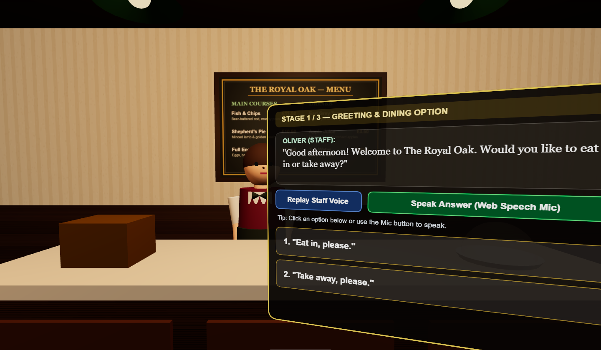

# 🍺 The Royal Oak — VR English Role-Play

A single-file WebXR scene for practising **English restaurant ordering**: you stand at the counter of a cosy British pub-restaurant, a stylised waiter named **Oliver** greets you by voice, and you answer either by clicking the on-screen options or by **speaking out loud** — the scene listens, matches your keywords, replies, and walks you through the whole order.

**▶ Live demo (works in a browser, a headset, or on a phone):** https://justinxox.github.io/vr-english-roleplay/

No build step, no server, no dependencies to install beyond the CDN copy of three.js. One HTML file.



---

## What it does

| Stage | Oliver asks | You answer |
|---|---|---|
| 1 | Eat in or take away? | "Eat in, please." / "Take away, please." |
| 2A | Which main course? | Fish & chips £11.50 · Shepherd's pie £10.50 · Full English £12.00 |
| 2B | Which drink? | Earl Grey tea £3.00 · Apple juice £3.50 · Tap water (free) |
| 3 | Confirm + total, how would you pay? | "By card, please." / "In cash, please." |
| 4 | Order complete — congratulation + restart | Restart the session |

Features:

- **Voice input** — Web Speech API (`SpeechRecognition`, `en-GB`), keyword matching with several alternatives per answer, plus a text status line telling you what it heard.
- **Voice output** — `SpeechSynthesis` picks an English (GB) voice for Oliver's lines; a **Replay Staff Voice** button repeats the current line.
- **3D WebXR** — `VRButton` + a player rig with `local-floor` eye height, controller **laser pointers**, hover feedback and trigger selection. Works on Meta Quest / PCVR browsers and stays fully playable on a flat screen.
- **Everything is procedural** — wood, plaster-and-stripe wallpaper, the brass footrail, the chalkboard menu board, the pendant lamps and Oliver himself are generated in code (no image or model assets), so the file is self-contained.
- **Animated waiter** — breathing, subtle head tracking, a wave on greeting, a nod when you pick an option, and mouth movement while he speaks.
- **Zero backend** — nothing is uploaded anywhere by this page (see [Privacy](#privacy)).

## Controls

**Desktop / laptop**

- **Drag** the mouse to look around the room.
- **Click** any option button floating in front of the counter (mouse cursor turns into a pointer over a live button).
- **Replay Staff Voice** — hear Oliver's current line again.
- **Speak Answer (Web Speech Mic)** — start/stop listening, then answer in English. Grant mic permission when the browser asks.
- If your browser blocks automatic speech on load, the first click anywhere starts the greeting.

**VR headset**

- Open the demo URL in the headset browser (Meta Quest Browser, Wolvic, …) and press **ENTER VR**.
- Point a controller at the panel, pull the **trigger** to select a button. Lasers show on both controllers.
- The mic button drives the headset browser's speech recognition, so you literally answer Oliver out loud while standing at the counter.

## Run it locally

WebXR and the microphone both require a **secure context**, so `file://` will render the room but the VR button and mic stay dead. Serve it over `localhost` instead:

```bash
git clone https://github.com/JustinXoX/vr-english-roleplay.git
cd vr-english-roleplay

# any static server works, pick one:
python3 -m http.server 8080        # → http://localhost:8080
# or: npx serve .
```

`http://localhost:8080` counts as a secure context, so VR and the mic work there. To test on a headset inside your LAN you need HTTPS — use a tunnel such as `cloudflared tunnel --url http://localhost:8080`, or just use the GitHub Pages URL above.

## Browser support

| Browser | Scene | Voice input | VR |
|---|---|---|---|
| Chrome / Edge (desktop) | ✅ | ✅ | ✅ with a WebXR headset |
| Meta Quest Browser | ✅ | ✅ | ✅ |
| Safari (macOS) | ✅ | ⚠️ partial (`webkitSpeechRecognition` may be missing) | ❌ |
| Firefox | ✅ | ❌ (no `SpeechRecognition`) | ✅ with WebXR headset |

If speech recognition is unavailable the panel says so and the option buttons keep working — the activity is never blocked by it.

## Privacy

The page has no server, no analytics and no storage. Two things are worth knowing:

- Oliver's **voice output** is generated locally by the browser's speech synthesizer.
- **Speech recognition is performed by the browser's own speech engine.** In Chrome-based browsers that means your microphone audio is processed by Google's speech service, subject to that browser's policy — the page itself never sees or keeps the audio beyond the transcript string, which lives only in memory until you reload.

## Repo layout

```
index.html    the whole experience (Three.js scene, WebXR rig, speech I/O, role-play state machine)
README.md     this file
LICENSE       MIT
```

## Roadmap ideas

Pulled from the code's own shape, in case anyone wants to extend it:

- More venues and vocabulary packs (café, airport check-in, doctor's appointment) — the `STAGES` array is the only thing to edit.
- A score/feedback pass (grammar hints when a transcript half-matches) instead of a binary match.
- Saved progress and a per-learner word list in `localStorage`.
- Additional languages: swap the `STAGES` strings and the `SpeechRecognition.lang` / `SpeechSynthesis` voice.

## Credits

Prototype generated with AI assistance (Google Gemini) from a one-file prompt, cleaned up for release. Scene, dialogue and code are MIT-licensed — see [LICENSE](LICENSE). `three.js` is loaded from jsDelivr and remains under its own MIT license.

## 中文簡介（繁體）

這是一個**單一 HTML 檔**的 WebXR 英語會話練習場景：你站在一間英式酒吧餐廳的櫃檯前，店員 Oliver 會用語音招呼你，你可以**點畫面按鈕**或**直接用麥克風講英文**回答，場景會聽、關鍵字比對、回覆，帶你走完點餐流程（內用／外帶 → 主菜 → 飲料 → 結帳 → 完成）。

- **線上即玩**：https://justinxox.github.io/vr-english-roleplay/
- **電腦**：拖曳滑鼠環視，點面板上的按鈕；「Speak Answer」開始用麥克風作答。
- **VR 頭盔**：在頭盔瀏覽器打開上面的網址，按 **ENTER VR**，用手把雷射指向面板、扣扳機選擇。
- **本機執行**：`python3 -m http.server 8080` 開 `http://localhost:8080`（`file://` 直接開會沒有 VR 與麥克風，因為兩者都需要 HTTPS／localhost 這種安全環境）。
- 沒有任何後端；語音辨識由瀏覽器自己的引擎處理。

授權：MIT，任何人都可以自由使用、修改、再發佈。
